# Beyond AUC: Credit Risk Probability Modelling, Calibration, and Model Validation

An Empirical Comparison of Interpretable Statistical Models and Machine Learning Under Sampling Bias and Limited Data

QUANTITATIVE RESEARCH  /  INDEPENDENT PORTFOLIO STUDY

Aryan Golbaghi  |  27 October 2026

### 1. Abstract

Credit-risk decisions require both useful risk rankings and credible outcome probabilities. This study asks whether gradient boosting earns its additional complexity over regularised logistic regression on the corrected South German Credit dataset. We compare a constant-prevalence baseline, logistic regression, gradient boosting and sigmoid-calibrated boosting on 1,000 historical records. A stratified 800/200 split reserves a final holdout; nested training-only cross-validation separates preprocessing, tuning and calibration. Evaluation includes discrimination, proper scoring rules, reliability diagrams and 2,000 paired stratified bootstrap resamples. Holdout AUC is 0.749 for logistic regression and 0.790 for boosting; the difference is +0.040 with conditional 95% interval [0.004, 0.077]. However, their mean outer-fold AUCs are 0.790 and 0.775, respectively. Calibration changes holdout Brier score by -0.00006 and log loss by +0.00049; both paired intervals include zero. These findings caution against selecting model complexity from a single favourable split. The deliberately enriched sample, uncertain outcome horizon and 1970s origin prevent interpreting its calibrated probabilities as contemporary portfolio default probabilities. This is a reproducible empirical model-validation exercise, with evidence for predictive signal but mixed evidence for a general boosting advantage and no demonstrated calibration benefit.

> A favourable holdout is evidence to examine, not a substitute for stable validation.

Research scope: historical bad-credit outcomes, probability quality and validation uncertainty. Prepared as an independent professional portfolio project; no bank sponsorship, affiliation or approval is implied.

## 2. Introduction and motivation

Credit risk is the risk that a borrower fails to meet contractual obligations. A probability of default model gives a probability for a specified event over a stated horizon, conditional on information available at prediction time. Such probabilities can inform expected-loss analysis when combined with exposure and loss severity assumptions. Those ingredients are not established by this historical benchmark.

Ranking and probability estimation answer different questions. ROC-AUC asks how often a randomly selected bad outcome receives a higher score than a good outcome, with half credit for ties. It is unchanged by a strictly increasing score transformation. Calibration asks whether, among observations assigned a probability near p, the outcome occurs about p of the time. A strong ranking can therefore coexist with systematically wrong absolute risk estimates. This distinction matters whenever probabilities enter valuation, loss estimates or decisions [6,10].

The study compares a transparent statistical benchmark with shallow-tree gradient boosting, rather than assuming flexibility improves a decision system. The career context is graduate quantitative analytics, including Barclays Risk Quantitative Analytics roles; this work was not conducted for or endorsed by Barclays.

### 3. Research questions and prespecified hypotheses

**Hypothesis framework: declared before model fitting in docs/protocol.md.**

| Hypothesis | Concern and planned evidence |
| --- | --- |
| H1: discrimination | Compare trained AUC with 0.5 in outer CV and the locked holdout. A lower interval above 0.5 supports predictive signal. |
| H2: complexity | Compare boosting minus logistic with paired intervals and fold-level signs. Stable positive evidence strengthens a complexity case. |
| H3: calibration | Contrast ranking with reliability diagnostics and scoring rules. Higher AUC with weaker calibration illustrates the distinction. |
| H4: intervention | Compare the same boosting model before and after sigmoid calibration. Consistent lower proper scores would support a benefit. |
| H5: sampling | Audit selection and explore hypothetical prior shifts. Population PD calibration cannot be established without external information. |

These are hypotheses, not target outcomes. The protocol does not specify an economically material improvement because no decision costs or representative portfolio are available. Contradictory and inconclusive findings are retained. The local protocol is auditable but was not externally preregistered.

## 4. Dataset, provenance and target meaning

The corrected UCI South German Credit release contains 1,000 records and 20 predictors. We retain the original archive, codebook and R reader, with SHA-256 checksums. The landing-page count of 21 includes the target; the parsed file confirms 20 predictors. The source and correction are attributed under CC BY 4.0 [1,2].

The codebook defines kredit=0 as bad and kredit=1 as good. The loader explicitly constructs Y=1[kredit=0], then renames the predictors. A test checks every label against the original file. The audit finds 0 missing cells, 0 duplicate records and 0 duplicate predictor vectors. No rows are removed.

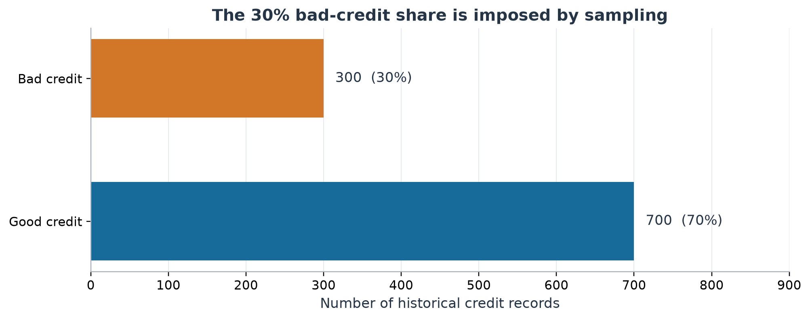

*Figure 2. Full-source outcome counts and proportions. These are integrity statistics; the enriched 30% bad-credit fraction is not an estimate of a bank's default rate.*

**Table 1. Training-only descriptive statistics. IQR flags use the 1.5-IQR rule and are retained.**

| Training variable | Median | Mean | Range | IQR flags |
| --- | --- | --- | --- | --- |
| duration | 18.0 | 20.9 | 4-72 | 56 |
| amount | 2252.0 | 3246.5 | 250-18424 | 63 |
| age | 34.0 | 35.7 | 19-75 | 14 |

Duration is in months and age in years. The amount is an unknown monotonic transformation of historical credit amounts: its numerical units cannot support currency or exposure calculations. All 17 other predictors are categorical or discretised quantities. One-hot encoding avoids imposing an unsupported equal-distance relationship between integer codes.

> Four distinct quantities: observed bad-credit outcome; modern horizon-specific default event; study-sample calibrated probability; representative-portfolio probability. This study estimates only the first outcome under the study's sampling design.

## 4. Dataset: exploratory evidence

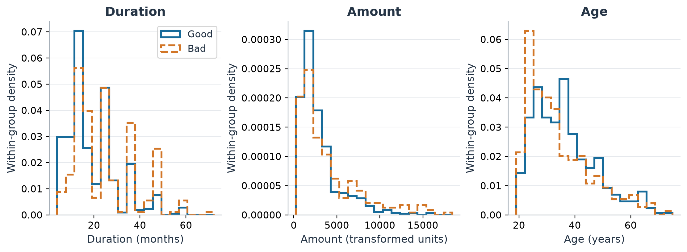

*Figure 3. Within-outcome densities of duration, transformed amount and age in the training partition. Common bin edges permit comparison; density normalisation prevents the majority class from dominating.*

Training medians are 18 months for duration, 2252 transformed units for amount and 34 years for age. The distributions differ in scale and have uneven tails. Scaling benefits penalised logistic fitting; the tree model does not require it but uses the same pipeline. Outlier flags do not establish errors, and were not used to trim either partition.

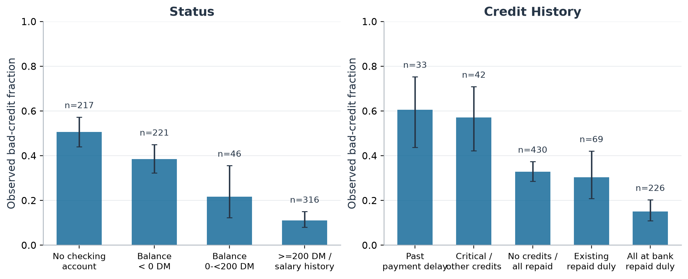

*Figure 4. Training-only bad-credit frequencies by checking-account status and credit history, with counts and descriptive 95% Wilson intervals. The intervals describe binomial sampling variation, not causal effects.*

The conditional patterns motivate examining nonlinear and categorical effects, while their overlapping intervals discourage overinterpreting sparse groups. These associations may reflect lending policy, selection and other predictors. They do not identify effects of changing a borrower's characteristics. Exploratory associations use the 800 training observations only; holdout outcomes did not guide feature choices.

## 5. Methodology: keep the holdout isolated

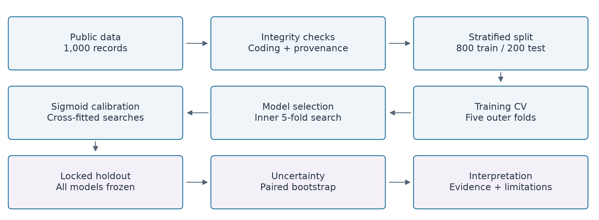

*Figure 1. Prespecified research workflow. Model selection and calibration are nested within training. The sequence is schematic: each calibration fold runs its own complete hyperparameter search before the final full-training model is fitted.*

**Table 2. Major partitions; both outcome classes occur throughout the design.**

| Partition | Total | Good | Bad | Purpose |
| --- | --- | --- | --- | --- |
| Source | 1000 | 700 | 300 | Integrity checks |
| Training | 800 | 560 | 240 | EDA, selection, calibration |
| Final holdout | 200 | 140 | 60 | Frozen-model evaluation |
| Each outer fit | 640 | 448 | 192 | Fit complete workflow |
| Each outer validation | 160 | 112 | 48 | Training-only stability |

The stratified split uses seed 42; row IDs are retained in split_manifest.json. Outer five-fold CV evaluates the complete learning procedure on the training set. Each outer fit runs a separate five-fold grid search scored by mean log loss. This prevents choosing hyperparameters on the same observations later used to estimate the workflow's outer-fold performance.

For calibrated boosting, the cross-fitted estimator is GridSearchCV itself. Each calibration observation is excluded from its score's imputation, scaling, model fitting and hyperparameter selection. The sigmoid is then fitted to these out-of-fold scores, and the base search is refitted on all available training data. With ensemble=False, raw and calibrated predictions share that exact fitted base model [9].

Within an outer fit, calibration folds use 512 fit / 128 calibration rows, with about 154 / 38 bad outcomes. Their inner tuning fits have 409-410 observations. The final calibration cross-fit uses 640 / 160 rows. This costs additional fitting but avoids optimistic calibration scores from global hyperparameter selection. It still assumes the score distribution transfers from smaller fitted models to the full-training model.

## 5. Methodology: models and probability quality

### Statistical baseline and flexible alternative

Logistic regression models a linear predictor on the log-odds scale [3]. Numerical effects are expressed per training standard deviation; each categorical effect compares a category with the first documented code. L2 shrinkage reduces instability but biases coefficients. Additive linear log-odds and the chosen reference coding constrain interpretation; neither standardised coefficients nor odds ratios are causal.

$$
p(x)=\frac{1}{1+\exp[-(\beta_0+\beta^T x)]}
$$

Gradient boosting adds shallow trees to reduce binomial deviance, capturing selected nonlinearities and interactions [4]. A deliberately small search limits adaptive overfitting. The constant model predicts training prevalence. Class weighting and synthetic oversampling are omitted because they would change the probability target. Median/mode imputation, scaling and encoding occur within every pipeline fit.

$$
F_M(x)=F_0+\eta\sum_{m=1}^{M}h_m(x),\qquad p(x)=\{1+e^{-F_M(x)}\}^{-1}
$$

**Table 3. Prespecified searches and full-training selections; selection criterion is log loss.**

| Workflow | Search | Selected on training |
| --- | --- | --- |
| Logistic | C: 0.1, 1, 10 | C = 0.1 |
| Boosting | Depth: 1, 2; rate: 0.05, 0.1 | Depth 2; rate 0.1 |
| Common boosting settings | 120 trees; minimum leaf 15 | No additional search |
| Calibration | Sigmoid; five cross-fit folds | Fixed a priori |

Sigmoid calibration is a two-parameter mapping of scores to probabilities. It is less flexible than isotonic regression, a deliberate variance trade-off for this small sample [5]. The fitted mapping is monotone here, so it changes probability values and thresholds while preserving AUC and average precision.

$$
\mathrm{BS}=\frac{1}{n}\sum_i(p_i-y_i)^2,\quad\mathrm{LL}=-\frac{1}{n}\sum_i[y_i\log p_i+(1-y_i)\log(1-p_i)]
$$

Both scores reward honest probabilities in expectation [6]. Brier score measures squared probability error; log loss penalises confident mistakes strongly. Both combine calibration and discrimination information. AUC and average precision describe ranking; AP is the recall-weighted average of precisions, not trapezoidal PR area. All metrics refer to the study sample. The threshold of 0.5 is illustrative, fixed before evaluation.

## 6. Experimental results: locked holdout

**Table 4. Final holdout performance, n=200 (60 bad). Higher AUC/AP and lower Brier/log loss are preferred.**

| Model | AUC | AP | Brier | Log loss |
| --- | --- | --- | --- | --- |
| Constant | 0.500 | 0.300 | 0.210 | 0.611 |
| Logistic | 0.749 | 0.574 | 0.175 | 0.525 |
| Boosting | 0.790 | 0.635 | 0.162 | 0.494 |
| Calibrated | 0.790 | 0.635 | 0.162 | 0.494 |

The constant baseline has AUC 0.500, AP 0.300 and Brier score 0.210. Both trained families contain predictive information. Logistic AUC is 0.749 with 95% interval [0.676, 0.821]; boosting AUC is 0.790 with interval [0.718, 0.855]. These intervals describe repeated sampling of this fixed holdout case mix, not refitting uncertainty.

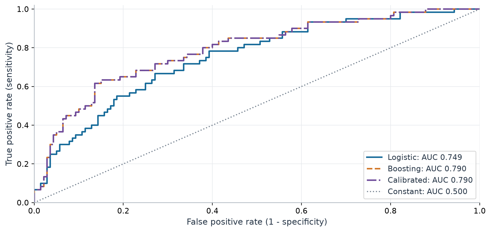

*Figure 5. ROC curves for the locked holdout. The calibrated and raw boosting curves overlap because the fitted sigmoid preserves the ranking. AUC describes pairwise ordering, not absolute probability accuracy.*

The boosting-logistic AUC difference is +0.040, with paired interval [0.004, 0.077]. The conditional interval excludes zero in favour of boosting. This is useful evidence for these frozen models on this partition, but training-fold instability must also be considered. Overlapping marginal AUC intervals are not used as a test of the paired difference.

No model was selected, retuned or recalibrated after observing these results. The selected hyperparameters and protocol hash were written to selection_locked.json before any holdout prediction. The final table reports every prespecified configuration, including the constant and calibrated models.

## 6. Results: precision and validation stability

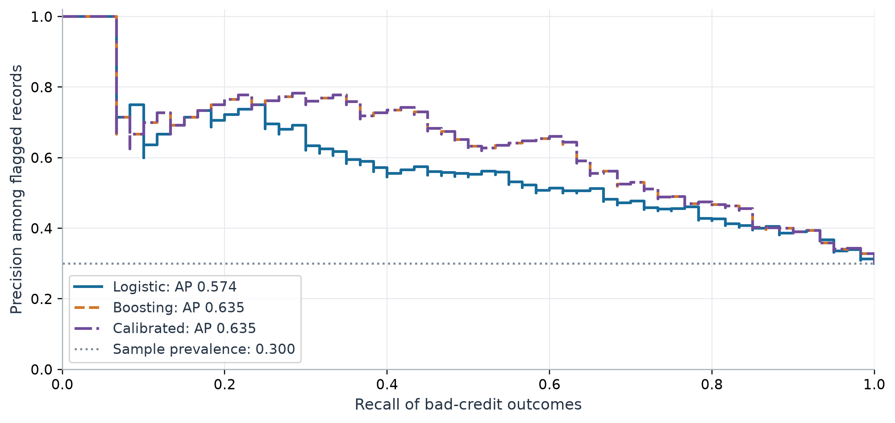

*Figure 6. Holdout precision-recall curves. AP depends on prevalence; the 0.300 reference applies only to this enriched sample. Calibrated and raw boosting have identical ranking metrics.*

Holdout AP is 0.574 for logistic and 0.635 for boosting, a difference of +0.062. This advantage does not imply the same precision in a less enriched portfolio.

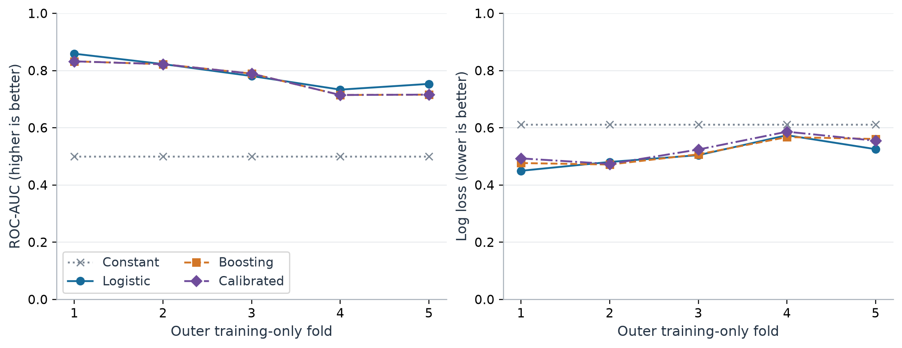

*Figure 7. Every training-only outer-fold AUC and log loss. The shared axis scales and constant baseline show the magnitude of variation. Folds reuse overlapping training data and are not independent experiments.*

**Table 5. Outer-fold mean and sample SD across five folds. All four metric summaries are saved in metrics.json.**

| Model | Outer AUC mean (SD) | Outer log loss mean (SD) |
| --- | --- | --- |
| Constant | 0.500 (0.000) | 0.611 (0.000) |
| Logistic | 0.790 (0.051) | 0.507 (0.047) |
| Boosting | 0.775 (0.057) | 0.517 (0.045) |
| Calibrated | 0.775 (0.057) | 0.526 (0.046) |

Boosting wins AUC in 1/5 folds; the fold differences range from -0.038 to +0.009. The contrast with the holdout is direct evidence that a single split can change the preferred model.

## 6. Results: reliability and calibration

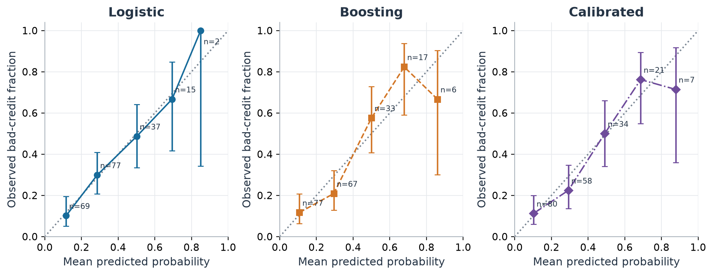

*Figure 8. Reliability in five fixed probability bins, with counts and descriptive Wilson 95% intervals. The diagonal is ideal calibration; intervals ignore fitting and within-bin heterogeneity.*

**Table 6. Evaluation-only calibration diagnostics. ECE uses the same five bins; lower is descriptive, not definitive.**

| Model | Joint intercept (SE) | Slope (SE) | Offset intercept | ECE |
| --- | --- | --- | --- | --- |
| Logistic | -0.033 (0.214) | 0.981 (0.189) | -0.020 | 0.016 |
| Boosting | -0.012 (0.210) | 1.038 (0.181) | -0.036 | 0.063 |
| Calibrated | -0.106 (0.201) | 0.946 (0.165) | -0.074 | 0.039 |

We estimate logit P(Y=1) = a + b logit(p) diagnostically on the holdout. Ideal joint intercept/slope are 0/1. A slope below one can indicate overly dispersed predictions; above one can indicate insufficient spread. The offset-only intercept fixes b=1 and measures calibration-in-the-large, a different quantity. These diagnostic fits never modify the reported predictions. Standard errors use observed Fisher information and a large-sample approximation, which is imperfect with only 60 bad outcomes.

The raw boosting slope is 1.038 (SE 0.181); after calibration it is 0.946 (SE 0.165). Logistic ECE is 0.016, compared with 0.063 for boosting. Thus the model with higher holdout AUC need not look better on a binned calibration diagnostic. The near-ideal slopes do not prove exact reliability across individual risk ranges.

The constant model has no identifiable calibration slope. Its pooled frequency can match prevalence while its ranking is uninformative, illustrating why calibration alone is insufficient. ECE also depends on bin boundaries: a small ECE is not a guarantee of accurate individual probabilities.

## 6. Results: probability mass and scoring rules

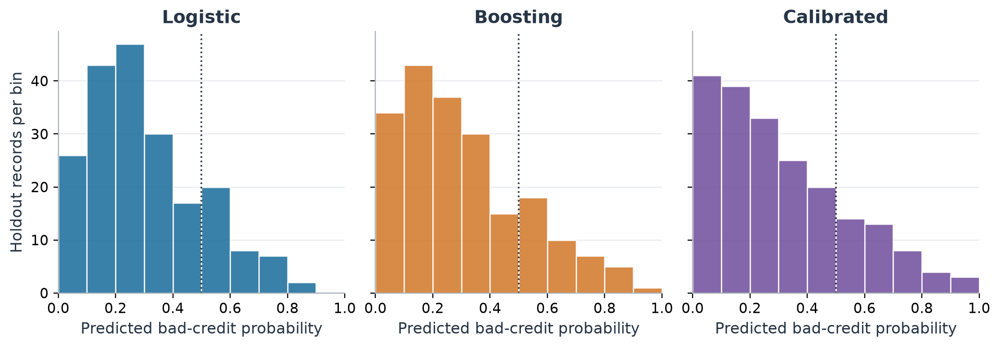

*Figure 9. Holdout probability distributions in ten bins. The dotted line is the fixed illustrative threshold; histogram bins are finer than the five-bin reliability diagnostic.*

Sparse high-probability regions constrain reliability assessment. The number of predictions at or above 0.8 is 2 for logistic, 6 for boosting and 7 after calibration. A small count can yield a visually large calibration departure from only a few outcomes. Five reliability bins are a compromise between resolution and variance.

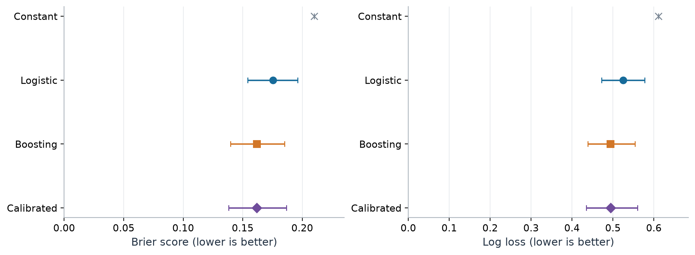

*Figure 10. Holdout proper scoring rules with conditional paired-bootstrap marginal intervals. Lower is better; axes start at zero. The constant's interval collapses because stratification fixes prevalence.*

Boosting Brier score is 0.16180 versus 0.17535 for logistic. Calibration changes Brier by -0.00006 and log loss by +0.00049. The directions differ and a consistent improvement is not established. The apparently improved reliability curve cannot replace this proper-score comparison.

Calibration reduces outer-fold log loss in 1/5 folds. Its mean outer log loss is 0.526, compared with 0.517 before calibration. This weakens an automatic-calibration policy for limited data. Isotonic regression was not added after seeing the result.

## 7. Statistical interpretation and uncertainty

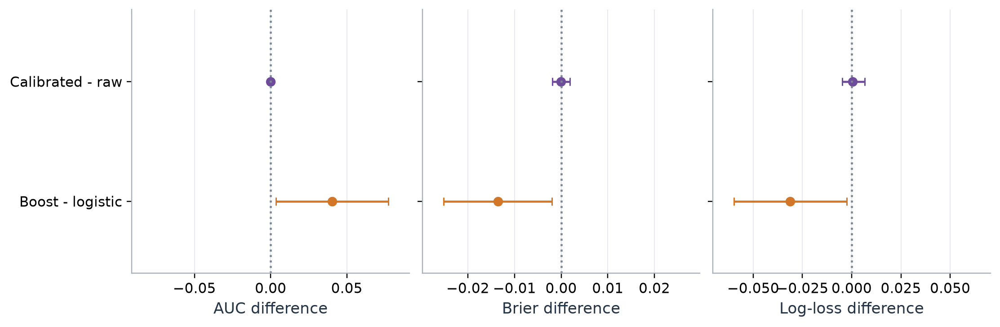

*Figure 11. Paired differences with 95% percentile intervals. Positive AUC and negative scoring-rule differences favour the first model. Each contrast uses the same resampled records for both models.*

**Table 7. Conditional paired comparisons; no multiplicity-adjusted global superiority claim is made.**

| Paired contrast | Metric | Difference | 95% interval |
| --- | --- | --- | --- |
| Boosting - logistic | AUC | +0.0404 | [0.0036, 0.0771] |
| Boosting - logistic | Brier | -0.0136 | [-0.0252, -0.0020] |
| Boosting - logistic | Log loss | -0.0312 | [-0.0597, -0.0025] |
| Calibrated - raw | AUC | +0.0000 | [0.0000, 0.0000] |
| Calibrated - raw | Brier | -0.0001 | [-0.0018, 0.0019] |
| Calibrated - raw | Log loss | +0.0005 | [-0.0048, 0.0065] |

The bootstrap draws 60 bad and 140 good rows with replacement, separately, for 2,000 replicates [7]. There were 0 one-class rejections. Percentiles 2.5 and 97.5 form the intervals; the code also detects one-class draws in an optional unstratified procedure. Paired draws retain correlation between model errors, making them appropriate for differences.

The conditional interval excludes zero in favour of boosting. However, outer-fold mean AUC difference is -0.015, with the opposite direction to the holdout. The holdout and outer folds answer related but different questions: performance of the final fitted models versus variation of the learning workflow trained on smaller samples. Neither observation should erase the other.

These are nominal conditional intervals across several related metrics, not a familywise test or a population guarantee. They exclude model retraining, source-bank prevalence, calendar drift and unknown borrower dependence. No p-value or independent-validation claim is made. Economic materiality remains undetermined without loss severity, exposure, decision costs and representative validation data.

## 8. Robustness and prevalence sensitivity

Analysis A is the training-only fold comparison: boosting leads in 1 of 5 folds, with a mean AUC contrast of -0.015. This probes partition and tuning sensitivity without reusing the holdout. Overlapping fit sets mean the folds are not independent observations for an ordinary t-test. Repeated CV or an alternative seed might extend this descriptive analysis, but would not create external validation.

Analysis B changes only the assumed class prior. From Bayes' theorem, source posterior odds equal the class-conditional likelihood ratio times source prior odds. If P_target(X|Y)=P_source(X|Y) and the source posterior is calibrated, replacing prior odds yields [8]:

$$
\frac{p_t(x)}{1-p_t(x)}=\frac{p_s(x)}{1-p_s(x)}\;\frac{\pi_t/(1-\pi_t)}{\pi_s/(1-\pi_s)}
$$

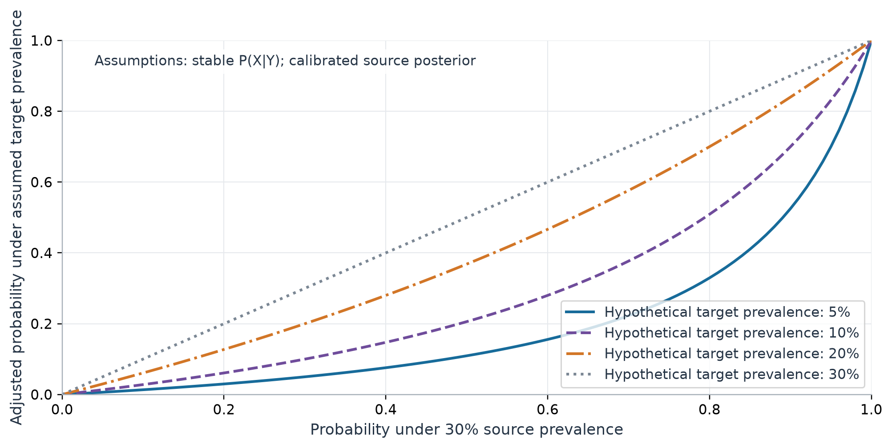

*Figure 13. Theoretical odds correction from a 30% source prior to explicitly hypothetical target prevalences. The map is monotone and preserves ranking, but changes probability levels substantially.*

**Table 8. Mathematical scenarios, not estimated bank default probabilities.**

| Assumed prevalence | Source p=0.30 | Source p=0.50 | Source p=0.80 |
| --- | --- | --- | --- |
| 5% | 0.050 | 0.109 | 0.329 |
| 10% | 0.100 | 0.206 | 0.509 |
| 20% | 0.200 | 0.368 | 0.700 |
| 30% | 0.300 | 0.500 | 0.800 |

For example, source probability 0.50 becomes 0.206 under an assumed 10% prior. This does not recover the bank's true prevalence, repair a misdefined outcome, or correct changes in lending policy and conditional feature distributions. The mean adjusted probability on the source sample need not equal the target prior because the source feature mixture has not been replaced.

## 9. Model risk: interpreting predictive factors


*Figure 12. Left: seven largest absolute regularised logistic coefficients. Suffixes denote category codes, relative to the first documented code; continuous effects are per training SD. Right: boosting permutation importance, mean plus/minus one SD across outer folds, not confidence intervals.*

The largest absolute logistic coefficient is status: ... >= 200 DM / salary for at least 1 year, with coefficient -1.140 relative to 1: no checking account. Its fitted conditional odds multiplier is 0.320. This is a penalised association holding other encoded predictors fixed, not an intervention estimate or an unpenalised inference result. Complete coefficients and reference labels are saved in logistic_coefficients.csv.

The largest mean permutation effects are status, duration, purpose. Shuffling status raises outer-validation log loss by 0.080 on average. Each raw feature is shuffled before preprocessing, preserving its one-hot group. Ten shuffles per fold reduce Monte Carlo noise. Correlated features can substitute for one another, and permutation can create implausible combinations; low importance is not proof that a variable is irrelevant.

### Demographics, proxies and representativeness

Age, foreign-worker status and combined personal status/sex are present. Housing, job and historical telephone access may also act as proxies. The personal-status code mixes male singles with female non-singles, so sex cannot be reliably reconstructed. A sex-based fairness score would be poorly founded. These variables are retained for a transparent historical comparison, not endorsed for use in lending decisions. Sparse subgroups and no decision-outcome study prevent fairness or compliance claims.

The data concern issued credits; extrapolation to rejected applicants is unsupported. Borrower identifiers and prediction timestamps are unavailable, preventing grouped or forward-time validation. Source-era features such as landline access have different meanings in a contemporary portfolio.

## 9. Model risk: decisions and responsible use

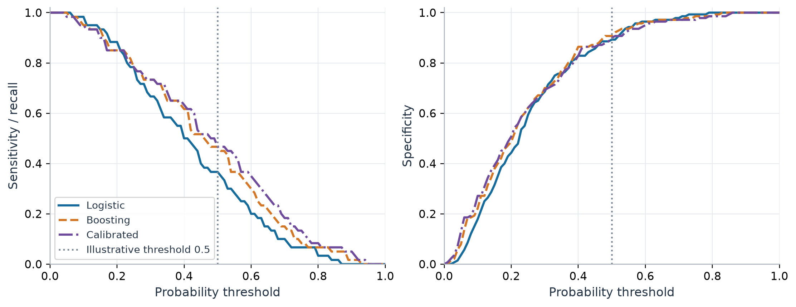

*Figure 14. Holdout threshold trade-offs. The prespecified 0.5 threshold is illustrative. The curves are descriptive and are not used to optimise a lending policy.*

**Table 9. Threshold 0.5. Constant precision is undefined because it flags no records.**

| Model | Sensitivity | Specificity | Precision | Flagged / 200 |
| --- | --- | --- | --- | --- |
| Constant | 0.000 | 1.000 | not defined | 0 |
| Logistic | 0.367 | 0.893 | 0.595 | 37 |
| Boosting | 0.467 | 0.907 | 0.683 | 41 |
| Calibrated | 0.467 | 0.900 | 0.667 | 42 |

At 0.5, boosting identifies 28 of 60 bad outcomes and flags 13 good outcomes. Logistic identifies 22 and flags 15, respectively. Calibration changes probability levels, but these counts provide no economic justification for the threshold. The sample omits exposure, loss severity, operational constraints, uncertainty in repayment timing and the consequences of approving or declining a loan.

### Evidence required before financial-risk use

A financial institution would first need a defined outcome and horizon; representative application and performance data with reliable timestamps; handling of maturity, censoring and rejected applications; and independently held-out calendar or external portfolios. Validation would include calibration by time and relevant segment, economic decision analysis, stability and stress tests, feature legitimacy and appropriate subgroup evaluation. Institutional governance and applicable requirements would need their own review; this report does not assess regulatory compliance.

The actual findings sharpen these needs: the model ranking changes across partitions, the calibration intervention lacks a consistent score benefit, and tail reliability rests on few observations. Deployment would additionally require data controls, documented ownership, monitoring for drift, recalibration rules, independent challenge and change management. None is established by this portfolio study.

## 10. What is different about this research?

The contribution is a controlled empirical comparison with explicit probability and model-risk questions, not a claim of a new learning algorithm. It tests whether complexity helps rather than selecting the largest score by default. It uses proper scoring rules and calibration diagnostics alongside ranking; keeps tuning inside calibration cross-fitting; isolates the sigmoid intervention by sharing its base estimator; reports paired uncertainty; and makes sampling assumptions visible through odds scenarios.

Reproducibility is part of the evidence. Source checksums, row-level split manifests, out-of-fold and holdout predictions, full small-grid results, bootstrap draws and figure inputs are retained. One structured narrative generates both report formats, while numerical statements are read from saved outputs. Meaningful tests cover source coding, leakage boundaries, metrics, calibration, bootstrap edge cases and complete artifact production.

### 11. Conclusion: what the experiments support

Boosting achieves holdout ROC-AUC 0.790 versus 0.749 for logistic regression, a difference of +0.040 (paired 95% CI [0.004, 0.077]). Yet boosting leads in only 1 of 5 training-only outer folds. The evidence supports a holdout-specific advantage, not a stable general preference for complexity.

H1 is supported within this sample: trained models discriminate beyond the constant. H2 is mixed: the holdout favours boosting, but outer-fold comparisons do not support a stable advantage. H3 is illustrated by the distinction between AUC and reliability diagnostics, not established as a universal empirical law. H4 receives no convincing benefit here: calibrated-minus-raw Brier is -0.00006 and log loss is +0.00049, with both paired intervals spanning zero. H5 remains a justified identification limitation: population calibration is not testable from this sample alone.

### What the experiments do not establish

They do not establish contemporary PD accuracy, economic value, causal effects, regulatory compliance, fair credit decisions or external validity. Nor does the mixed evidence prove model equivalence. Conditional bootstrap precision cannot replace representative data or uncertainty from repeated fitting.

### Practical implications and next research steps

Logistic regression remains a credible benchmark when transparent interpretation and limited data matter. Boosting merits further investigation because of its holdout performance, but its complexity is not justified by a robust population-level superiority finding. Next steps are a larger representative time-stamped cohort, a defined default horizon, external or forward-time validation, assessment of training variability, subgroup analysis with valid attributes, and institution-specific decision costs. Additional model families would be secondary to improving those data and validation conditions.

## 12. References and reproducibility

[1] UCI Machine Learning Repository (2019). South German Credit [Dataset]. CC BY 4.0. [Source](https://doi.org/10.24432/C5X89F)

[2] Grömping, U. (2019). South German Credit Data: Correcting a Widely Used Data Set. Report 4/2019, Beuth University of Applied Sciences Berlin. [Source](https://www1.beuth-hochschule.de/FB_II/reports/Report-2019-004.pdf)

[3] Cox, D. R. (1958). The Regression Analysis of Binary Sequences. Journal of the Royal Statistical Society, Series B, 20(2), 215-232. [Source](https://doi.org/10.1111/j.2517-6161.1958.tb00292.x)

[4] Friedman, J. H. (2001). Greedy Function Approximation: A Gradient Boosting Machine. Annals of Statistics, 29(5), 1189-1232. [Source](https://doi.org/10.1214/aos/1013203451)

[5] Niculescu-Mizil, A., and Caruana, R. (2005). Predicting Good Probabilities With Supervised Learning. Proceedings of the 22nd International Conference on Machine Learning. [Source](https://www.cs.cornell.edu/~alexn/papers/calibration.icml05.crc.rev3.pdf)

[6] Gneiting, T., and Raftery, A. E. (2007). Strictly Proper Scoring Rules, Prediction, and Estimation. Journal of the American Statistical Association, 102(477), 359-378. [Source](https://doi.org/10.1198/016214506000001437)

[7] Efron, B. (1979). Bootstrap Methods: Another Look at the Jackknife. Annals of Statistics, 7(1), 1-26. [Source](https://doi.org/10.1214/aos/1176344552)

[8] Saerens, M., Latinne, P., and Decaestecker, C. (2002). Adjusting the Outputs of a Classifier to New a Priori Probabilities: A Simple Procedure. Neural Computation, 14(1), 21-41. [Source](https://doi.org/10.1162/089976602753284446)

[9] scikit-learn contributors. Probability calibration and CalibratedClassifierCV documentation. Accessed 27 October 2026; executed version recorded in results/run_manifest.json. [Source](https://scikit-learn.org/stable/modules/calibration.html)

[10] scikit-learn contributors. Metrics and scoring: ROC-AUC, average precision, Brier score and log loss. Accessed 27 October 2026. [Source](https://scikit-learn.org/stable/modules/model_evaluation.html)

### Reproduce the study from the repository root

```bash
python -m pip install -e ".[dev]"
python -m pytest -q
python -m credit_risk all
python -m credit_risk verify
```

On systems with make, the equivalent workflow is make test followed by make all. A fresh Python 3.11+ virtual environment is recommended. requirements-lock.txt records the executed dependency versions. The original public archive is included with attribution; network access is required only to install dependencies or restore absent source files. The report command rebuilds presentation without refitting.

Audit trail: results/metrics.json, cv_results.csv, holdout_predictions.csv, bootstrap_intervals.csv, split_manifest.json and run_manifest.json. The final artifact manifest hashes deliverables. All fourteen figures are available as PNG and SVG. No model artifact is needed because the study can refit from its compact source data and fixed protocol.
